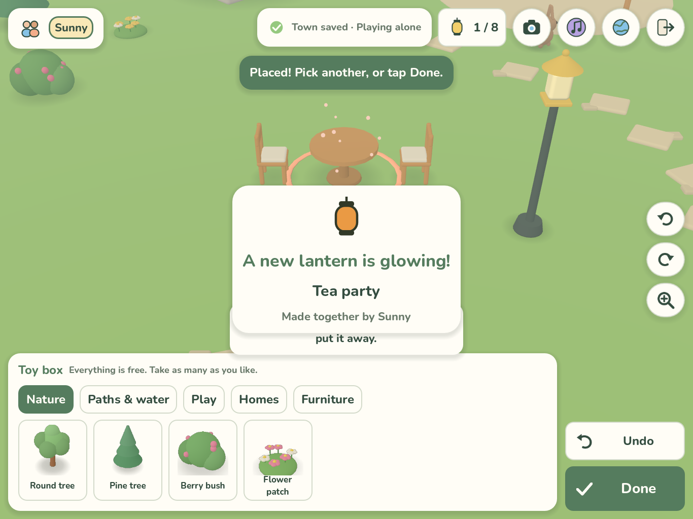

# Lantern Lane

Controller hint layout now follows tab/scroll changes without the previous 200 ms delay, including disabled readable controls. The focused regression is `res://tests/hint_tour.gd`; see r3 validation (local validation record).

A cozy 3D iPad and iPhone game built with **Godot 4.7.2**, in which two to four children decorate a shared town from their own homes. They place three-story cottages, gardens, ponds, swings and furniture (with a decoration on a table top), form **Cozy Spots** that light lanterns on the Wishing Tree, explore a 52 × 44 m countryside with five animal friends, and play in what they build, to a gentle original soundtrack. Eight optional activities invite play without quests or currency: animal wishes, hide-and-seek with a golden acorn, gift bundles, little gardens, a dance party, open-house hearts and guest books, photo ideas and weather. The toy box holds 163 items, 140 of them modeled furniture and decorations (including wall and ceiling items), all free from the start.

In development (candidate `unified` r1, freeze ID **unified-r1**, not released, protocol 20, save schema 3): one build with three destinations from the town's tram stop besides the zoo and the city. **Thousand Town** (below, unchanged), the **Roller Coaster Workshop** (Workshop r4 from the Mac: six coasters in one park, quick boarding from illustrated cards, three views, tools/coaster/README.md) and the **Lantern Reef** (the Mac's native Godot dive informed by the MIT "Abyssal Garden": kelp, fish schools, the wreck and the whale-tail sculpture, the player's own child swimming by touch or controller, four camera views). Each entry returns the child to the stop with the town as it was. See [design/unified-station.md](design/unified-station.md).

In development (candidate `thousand-town` r1, not released, **protocol 20**, save schema 3): **Thousand Town**, a second destination by tram. A native port of the CC BY 4.0 town "Qianren Xiaozhen (Thousand Town)" by Yihuishi / YiHuiShiBY: 1,000 residents with daily routines, buses, the canal waterfront, the night market, fireworks and a fountain show, with Day, Dusk, Night and Auto. The child explores on foot and can meet a resident and follow their commute, see who is in a building, ride a scheduled bus or the ferris wheel, buy a snack at the night market and watch the shows, by touch or the TV controller. See [design/thousand-town.md](design/thousand-town.md).

In development (candidate `city-web` r1, not released, protocol 19, save schema 3, on top of city r3): **a second city drawn by Three.js**, to evaluate Three.js on the devices that run the game.
- **A choice in the game:** at the tram stop, "Ride to the city (web)" goes to a second, separate city map beside the Godot city. It is the same city, exported from Godot's own builder, and Three.js draws it in an in-app web view. Children in one city do not see the other.
- **Still the game:** Godot keeps the session, the child's walking and actions, friends and the shared city state. The page draws the city, the people, the rides and the weather, owns the camera (Look, Pause, pan, zoom), and sends taps back to Godot.
- **Where it is offered:** iPad and iPhone (with the WebView plugin), and desktops started with `--web-city` for testing. Never on Apple TV, which has no web view; a separate native route for Apple TV is under study ([design/city-threejs.md](design/city-threejs.md) §7).
- **A fix to both cities:** the top-floor ceiling lights of the office, the gym and the cafe were built in the wrong place, two sets of them in the sky. They are now under their ceilings.
- **Measuring:** `--city-bench=godot|web` plays the same path through either city and logs frame times, memory and thermal state on the device.

Sealed earlier: candidate `city` r3 (protocol 18), **weather in the city**.
- **The palette:** a blue main building, a coral-orange tower, a warm-yellow cafe, mint shops, dark-green roofs and a berry-red wheel.
- **Weather:** three small glass buttons on the right choose sunny, rain or night for everyone in the city, blending smoothly.
  - **Rain:** rain falls, the ground turns wet and glossy, and people outdoors hurry to cover in staggered groups or open umbrellas, then come back after.
  - **Night:** deep blue with steady warm windows, signs, street lamps, light pools and a lit wheel.
- **Controls:** right drag pans the view (on a computer).
- **Stability:** nothing flickers or pops during glides, drags, zooms or weather changes.

Sealed earlier: candidate `city` r2 (protocol 17), **the city comes alive**.
- **Colour:** brighter, cleaner colours and softer light.
- **People:** about 50, with varied looks, each at work, at a meal, at exercise, in a shop, walking or riding, all on staggered timing.
- **Furnishing:** more of it, and simple English signs.
- **Rides:** a carousel whose horses bob and face the way it turns.
- **Traffic:** three coloured buses that keep their spacing and pause at four stops.
- **Look:** a button that turns taps into camera glides into a building, shop or ride, back out on empty space or Esc, with **Pause** for a closer look. The child stays and plays as before.

Sealed earlier: candidate `city` r1 (protocol 16, save schema 3, on top of zoo r2), **the miniature city district**, a third map reached by tram from town. It is a voxel city block on a white world:
- **Buildings:**
  - a blue office with desks, computers and bookshelves;
  - a yellow cafe with a coffee bar and a roof terrace;
  - a coral tower with a furnished terrace and a rooftop restaurant;
  - five shops with English signs, display windows and outdoor seating.
- **Getting around:** stairs and skywalks; the child walks on every floor with collision, and a tap picks the floor that shows.
- **The wheel:** a Ferris wheel the child can ride, boarding and getting off at the bottom.
- **The streets:** roads with a bus and two cars, and walkers on the pavement.
- **Camera:** an overview that fits the whole block, drag to orbit, pinch or wheel to zoom, and **Reset view**. On a controller, L / R turn and ZL / ZR zoom.
- **Shared:** seats, machines and the wheel are shared with friends, and late joiners see the same city.

See [design/city-district.md](design/city-district.md). No visual or device acceptance has happened yet.

Zoo r2 (sealed, not released, protocol 15, save schema 3, on top of the installed zoo r1): the six Everything Library animals (CC BY 4.0, David OReilly) in the real zoo.
- **Rory, Topper, Zig and Zag:** now use the imported lion, giraffe and zebra meshes, skinned and driven by their existing rigs, so every action stays.
- **New residents:**
  - Bao the panda, in a new Bamboo Grove;
  - Mabel the elephant, in Savanna Meadow;
  - Pebble and Flip the penguins, in Splash Bay.
- **Avoidance:** every ground and water animal avoids the others on the authority.

See `docs/zoo-engineering-standard.md` section 11.

Zoo r1 (installed; protocol 14, save schema 3, on top of `first-steps` r12): **the zoo**, a second map reached by a tram from a stop near where a child arrives in town. Fourteen animals of seven species (Rory the lion, Honey the lioness, Tango the tiger, five monkeys, Topper the giraffe, Zig and Zag the zebras, Bubbles the hippo, Skip and Ripple the otters) live on Lion Hill, Tiger Hill, Monkey Hill, Savanna Meadow and Splash Bay. They play on their own and answer a child's waves, cheers and dances, stations and treats. The zoo has its own toy box (Zoo and Picnic), a Look view for one animal, a "Zoo friends" scrapbook page, four photo ideas, and a camera that turns in 45 degree steps and zooms to 8, 9.5 or 15 m (zoo only). **Ride home** is always on screen there. See [design/zoo-and-world-journeys.md](design/zoo-and-world-journeys.md) and [the engineering standard](docs/zoo-engineering-standard.md). No visual or device acceptance has happened yet.

In development (candidate `first-steps`, not released, on top of `town-play`): a first-minute guide for a child who is new on a device (how to walk, build and find ideas, one line at a time, then never again) and a second section in the Activities guide that leads to the newer play. See [design/first-steps.md](design/first-steps.md).

In development (candidate `town-play`, not released, protocol 13, on top of `puzzle-rides`): lighting lamp posts by hand with an evening moment, signal rails, weather bells, a shared 8 x 8 picture board, hellos left for friends who are not online, and an animal friend riding in the cart's trailer. See [design/town-evenings-and-more.md](design/town-evenings-and-more.md) and the [experience plan](design/experience-plan.md).

In development (candidate `puzzle-rides`, not released, protocol 12): **puzzle rooms** (a treasure chest, keys, picture dials and clue cards a child sets up for friends) and **rideable carts** (a ring of 2 m rails and a cart to ride round it). See [design/puzzle-rooms-and-rides.md](design/puzzle-rooms-and-rides.md).

- Game design: [docs/game-design.md](docs/game-design.md) · Animal friends: [docs/animals.md](docs/animals.md)
- Object scale and table-top contract: [design/object-scale-and-surfaces.md](design/object-scale-and-surfaces.md)
- Activities A-H: [design/playfulness-proposals.md](design/playfulness-proposals.md) · Model release r1 coverage and next-run guide: [design/model-release-r1.md](design/model-release-r1.md)
- Asset provenance and licenses: [docs/assets.md](docs/assets.md) · Contributing (keep docs current with every change): [CONTRIBUTING.md](CONTRIBUTING.md)
- Apple TV with a game controller (Nintendo Switch Pro; Siri Remote Menu returns to the Home screen at the title): [design/tv-controller.md](design/tv-controller.md) · device results [docs/tv-validation.md](docs/tv-validation.md) · required engine patch [tv/engine/README.md](tv/engine/README.md)
- Handoff (status, tests, remaining issues): [HANDOFF.md](HANDOFF.md)
- Current release: [release status](docs/release-status.md) · Standard device/server publishing: [release workflow](docs/release-workflow.md)
- Multiplayer approach: [docs/multiplayer.md](docs/multiplayer.md)
- Development environment report: [docs/environment-report.md](docs/environment-report.md)
- Project-local EC2 Opus / Mac Godot workflow: [docs/dual-host-modeling.md](docs/dual-host-modeling.md)
- Requirements and history: [docs/requirements.md](docs/requirements.md) · Validation record: [docs/validation.md](docs/validation.md)



## Repository layout

```text
game/                 Godot project (open game/project.godot)
  scripts/core/       Pure game rules: catalog (scale contract), town model (rooms, table tops,
                      wall/ceiling mounts), Cozy Spots, animal brain, wishes, hide-and-seek,
                      photo ideas, avatars, palette
  scripts/net/        Session (solo, host, client, dedicated server), Animals and Activities autoloads
  scripts/world/      3D town, activity visuals, camera, local player and decorating controller
  scripts/art/        Procedural toy-like models for props and children
  scripts/ui/         HUD, menus, theme/icons, catalog thumbnails
  scripts/autoload/   Localization (six languages), music and settings, synthesized sounds
  assets/audio/       Original music loop (see docs/assets.md)
  assets/models/      140 modeled GLBs: 10 from art/pilot-10-v1, 130 from art/production-r1 (scale baked in)
  locale/             UI catalogs: en, zh-CN, ja, es, fr, de (English is the source)
  assets/fonts/       OFL fonts (Nunito; M PLUS Rounded 1c and Noto Sans SC subsets)
  tests/              Unit/session tests, rendered tour, network bots, probes
  export_presets.cfg  Generic iOS export preset "iPad" for iPhone and iPad (placeholder bundle ID, no Team ID)
art/pilot-10-v1/      Reviewed modeled furniture: GLBs, builders, manifests, modeling skill (rebuild.sh)
art/production-r1/    Release r1 models: release manifest, frozen batch records, builders, skill
design/               Earlier browser design preview, concept art and the object scale contract
docs/                 Design, requirements, validation, environment and multiplayer notes
scripts/              Tool setup, Godot wrapper, test runners, string, font and music tools
```

## Open and run

On a Mac or PC with Godot 4.7.2: open `game/project.godot` and press Play. On this Linux host, use the project-local tools:

```sh
scripts/setup_tools.sh                     # Godot 4.7.2 + Python venv + fonts into tools/ (git-ignored)
scripts/godot.sh --path game               # run the game (needs a display; on EC2 prefix: xvfb-run -a)
scripts/godot.sh --headless --path game -- --server --port=9080   # dedicated town server
```

Touch: tap the ground to walk; tap a door, stairs, swing, bench or animal to use it or say hello; Decorate opens the toy box, and dragging an item onto a table sets it on top. While a thing is held the placement tools sit at the bottom edge or under the top bar, keeping off the item and the child. Desktop controls for testing: click the ground to walk; WASD/arrows to walk; Q/E rotate the view (in town and the zoo); Z zoom (two steps in town, three in the zoo); Space for the context action; R turn, Enter place, Esc cancel, Ctrl+Z undo; keys 1–4 for emotes.

## Tests

```sh
scripts/test_all.sh            # all standing checks (rendered tours need xvfb-run)
scripts/test_all.sh --quick    # repository checks, headless unit/session tests, script parse, release-tool tests, generated-catalog checks
```

| Check | Command |
|---|---|
| Repository: locales, placeholders, extracted UI strings, font coverage, English sources, links | `tools/venv/bin/python scripts/check.py` |
| Music loop: format, length, headroom, loudness, seam | `python3 scripts/check_audio.py` |
| Placement tools never cover the item (three screen shapes, real drags) | see `scripts/test_all.sh` (`tests/dock_tour.gd`) |
| Rules, saves and migration, rooms and stairs, table tops, wall/ceiling mounts, scale contract and every modeled GLB, Cozy Spots, animals, activity rules (wishes, gifts, gardens, hearts and visits, photo ideas, hide-and-seek warmth), placement-tool logic, toy box search and filters (with a 2,000-entry test-only fixture), tap disambiguation, music settings, locales, solo session | `scripts/godot.sh --headless --path game -s res://tests/run_tests.gd` |
| Multiplayer with real WebSocket client processes, persistence across server restart | `python3 scripts/net_test.py` |
| Activities with real clients (conflicting starts, late joiner, presents, hearts, restart) | `python3 scripts/net_test.py --activities` |
| Apple TV controller tour (every step by simulated controller events: menus, TV join screen, walk and deadzone, camera, dialogs hold the world, context action, camera photo and scrapbook, Decorate, B safety, Swap A and B, six languages, disconnect, storage; `--phase=reopen` after a relaunch; `--phase=defaults` then `defaults_restart` on the TV for the native save module; result in `user://tv_tour_result.json`) | `scripts/godot.sh --headless --path game -- --driver=res://tests/tv_tour.gd --tv --pad-layout=nintendo --no-shots --window=1920x1080 --tag=atv` (device: `--tv --shots=user://tv_shots --tag=atv`) |
| Apple TV brand art (13 PNGs at Apple's sizes from `tv/brand/src`) | `python3 tv/brand/make_brand.py && scripts/godot.sh --headless --path game -s res://tests/tv_brand_rasterize.gd` |
| TV repository checks (all of `check.py` except Markdown links) | `tools/venv/bin/python scripts/tv_check.py` |
| Decorative motion (fan blades, sway, glow; Reduce motion by real taps; frozen-after-toggle pixels; stairs, removal, reload; a timed 17-decoration workload) | `scripts/godot.sh --path game --resolution 2208x1024 -- --driver=res://tests/motion_tour.gd --shots=/abs/dir --tag=iphone --safe-insets=154,0,154,55 --locales=de,ja` (logic only: `--headless`, `--no-shots --window=2208x1024`) |
| Joining a town above 64 KiB (synthetic 420-item town: whole town arrives unchanged; old 64 KiB server or client buffers fail clearly; the welcome limit refuses clearly; a silent server times out after 20 s; saves keep every item) | `python3 scripts/net_test.py --connect` |
| Animals visiting houses with real clients (invite, same-room view, emote answer, stairs, a late joiner, a disconnect inside, restart) | `python3 scripts/net_test.py --visits` |
| Animals visiting houses through the real UI (card, follow to the door, living room, dance answer, stairs, Say goodbye, back outside) | `scripts/godot.sh --path game --resolution 2208x1024 -- --driver=res://tests/visit_tour.gd --shots=/abs/dir --tag=iphone --safe-insets=154,0,154,55 --locales=de,ja` (logic only: `--headless`, `--no-shots --window=2208x1024`) |
| Two-seat benches with three real clients (two sit at once on different seats, a third is refused and then takes a freed seat, a disconnect frees a seat, restart) | `python3 scripts/net_test.py --seats` |
| Two-seat benches through the real UI (tap to sit, a friend beside you, full-bench message, Get up, turned sofa and town bench, outfits) | `scripts/godot.sh --path game --resolution 2208x1024 -- --driver=res://tests/bench_tour.gd --shots=/abs/dir --tag=iphone --safe-insets=154,0,154,55 --locales=de,ja` (logic only: `--headless`, `--no-shots --window=2208x1024`) |
| Contraptions and a living town: rules, the animal brain, the authority (in `run_tests.gd`: `test_contraption_rules`, `test_town_life_rules`, `test_living_brain`, `test_contraptions_session`) | `scripts/godot.sh --headless --path game -s res://tests/run_tests.gd` |
| Contraptions and a living town with real clients (the same chain on every device, a far press refused, a step on the pad, what an animal is busy with, a late joiner, restart) | `python3 scripts/net_test.py --contraptions` |
| Contraptions and a living town through the real UI (the toy box tab, links in Decorate, Press, the chain, a step pad, Wooly and the music box, Pip and a new thing, Reduce motion, room lights by day, each language) | Touch: `scripts/godot.sh --path game --resolution 2208x1024 -- --driver=res://tests/contraption_tour.gd --shots=/abs/dir --tag=iphone --safe-insets=154,0,154,55 --locales=en,zh-CN,ja,es,fr,de`. Controller: `--resolution 1920x1080 -- --driver=res://tests/contraption_tour.gd --tv --pad-layout=nintendo --shots=/abs/dir --tag=atv --locales=en,ja` (logic only: `--headless`, `--no-shots --window=WxH`) |
| Puzzle rooms and rideable carts: rules, saves, scale and clearance, the authority (solve, start again, edits, a friend leaving, reload; seat contention, go and stop, rails changed under way, a dropped connection) | `scripts/godot.sh --headless --path game -s res://tests/puzzle_ride_tests.gd` |
| Puzzle rooms and rideable carts with real clients (a shared puzzle, a far hand refused, a taken cart, a late joiner, a connection dropped mid-ride, Start again, restart) | `python3 scripts/net_test.py --puzzles` |
| Puzzle rooms and rideable carts through the real UI (the two toy box tabs, the puzzle's lines in Decorate, the chest's card, key, dial, open, Start again, Reduce motion; rails, Get in, Go!, Stop, Get off, the end of the rails; the toy box rebuilt while choosing; each language). Its town is its own save, deleted at every start | Touch: `scripts/godot.sh --path game --resolution 2208x1024 -- --driver=res://tests/puzzle_ride_tour.gd --shots=/abs/dir --tag=iphone --safe-insets=154,0,154,55 --locales=en,zh-CN,ja,es,fr,de`. Controller: `--resolution 1920x1080 -- --driver=res://tests/puzzle_ride_tour.gd --tv --pad-layout=nintendo --shots=/abs/dir --tag=atv --locales=en,zh-CN,ja,es,fr,de` (logic only: `--headless`, `--no-shots --window=WxH`) |
| First steps and the guide's second section: the state, the six new guide cards, their pictures, labels and translations | `scripts/godot.sh --headless --path game -s res://tests/first_steps_tests.gd` |
| Inside a cottage while a thing is held (first-steps r9, r10, r11): the tools never touch the child (meshes and name tag) or the thing (its own meshes), the child whole on screen; (r10) the thing whole inside the safe area, no shown side menu or top bar part on the child or the thing, a menu that steps aside takes no press and is no controller target, and every menu is back after Cancel and Place here; a table, a bookshelf, a wall painting and a ceiling mobile at every spot, the child at four places | Touch: `scripts/godot.sh --path game --resolution 2208x1024 -- --driver=res://tests/room_tools_tour.gd --shots=/abs/dir --tag=iphone --safe-insets=154,0,154,55 --locales=en,zh-CN,ja,es,fr,de`. Controller: `--resolution 1920x1080 -- --driver=res://tests/room_tools_tour.gd --tv --pad-layout=nintendo --shots=/abs/dir --tag=atv --locales=en,zh-CN,ja,es,fr,de` (logic only: `--headless`, `--no-shots --window=WxH`; `--spots=few` limits later languages; r11: `--extra-shots=de/table/back/-3,2;…` also saves the frame of those cases in any language; r12: the TV tours' `go_to` brings a button wholly hidden in a list into view with the D-pad) |
| The placement tools take no press while unseen after a pick, and work once shown (first-steps r9): a finger, and on a controller its pointer with A and its Turn button | Touch: `scripts/godot.sh --path game --resolution 2208x1024 -- --driver=res://tests/unseen_tools_tour.gd --tag=iphone --safe-insets=154,0,154,55 --no-shots`. Controller: `--resolution 1920x1080 -- --driver=res://tests/unseen_tools_tour.gd --tv --pad-layout=nintendo --tag=atv --no-shots` (logic only: `--headless`, `--window=WxH`) |
| First steps through the real UI (a new child is told how to walk, build and find ideas; each line goes when done; never again; Hide; a child who already plays sees nothing; the guide's second section and where each card leads; each language). Needs `--first-steps` and a fresh user-data folder | Touch: `scripts/godot.sh --path game --resolution 2208x1024 -- --driver=res://tests/first_steps_tour.gd --first-steps --shots=/abs/dir --tag=iphone --safe-insets=154,0,154,55 --locales=en,zh-CN,ja,es,fr,de`. Controller: `--resolution 1920x1080 -- --driver=res://tests/first_steps_tour.gd --first-steps --tv --pad-layout=nintendo --shots=/abs/dir --tag=atv --locales=en,zh-CN,ja,es,fr,de` (logic only: `--headless`, `--no-shots --window=WxH`) |
| Town evenings and more (lamplighter walk, signal rails, weather toys, picture board, friend echoes with expiry, deletion, saves and damaged data, animal passengers): rules and the authority | `scripts/godot.sh --headless --path game -s res://tests/town_play_tests.gd` |
| Town evenings and more with real clients (the evening moment for both, a shared picture, a far brush and a far answer refused, a hello answered, the weather bell, a late joiner, restart) | `python3 scripts/net_test.py --townplay` |
| Town evenings and more through the real UI (light a lamp and the evening moment, a signal rail, the weather vane and bell, the picture board's card, a hello left, played, answered and taken away, an animal in the trailer; each language). Its town is its own save | Touch: `scripts/godot.sh --path game --resolution 2208x1024 -- --driver=res://tests/town_play_tour.gd --shots=/abs/dir --tag=iphone --safe-insets=154,0,154,55 --locales=en,zh-CN,ja,es,fr,de`. Controller: `--resolution 1920x1080 -- --driver=res://tests/town_play_tour.gd --tv --pad-layout=nintendo --shots=/abs/dir --tag=atv --locales=en,zh-CN,ja,es,fr,de` (logic only: `--headless`, `--no-shots --window=WxH`) |
| The zoo: map data and layout rules, the camera's footprint, the animals' brain (Monkey Hill's repertoire, Reduce motion, seeds, answers, stations, treats, toys, keep-clear, the lions' den in the rain), models (heights, draw calls, triangles, matte), readability where each animal stands, the tram stop in the first view | `scripts/godot.sh --headless --path game -s res://tests/zoo_tests.gd` |
| The zoo's camera (turns and three zooms in the zoo only; arrival view, the town's view restored; Reduce motion) | `scripts/godot.sh --headless --path game -s res://tests/zoo_camera_tests.gd` |
| The zoo's structures, stations, toys and tram stop (kinds, bounds, budgets) | `scripts/godot.sh --headless --path game -s res://tests/zoo_props_tests.gd` |
| Schema 3: migration, the schema-2 `.bak` projection, the `.maps` sidecar, the `.v2` copy, the tram stop rules, real old saves | `scripts/godot.sh --headless --path game -s res://tests/zoo_save_tests.gd` |
| Protocol 14: travel, zoo stations and treats, who receives zoo states, stale states, the zoo invitation | `scripts/godot.sh --headless --path game -s res://tests/zoo_net_tests.gd` |
| The zoo's guide card, scrapbook page, photo ideas and strings in six languages | `scripts/godot.sh --headless --path game -s res://tests/zoo_ui_tests.gd` |
| The zoo with real clients (two maps at once, the invitation, a late joiner, a drop mid-journey, restart) | `python3 scripts/net_test.py --zoo` |
| The city: navigation (floors, stairs, skywalks, walls, picking through cutaways), a walk along every route at three stride lengths, the shared rules (seats, machines, the wheel), the camera (overview, orbit, zoom, gestures), the art and its budgets, the shared state and late joiners | `for t in city_nav_tests city_walk_tests city_rules_tests city_orbit_tests city_art_tests city_net_tests; do scripts/godot.sh --headless --path game -s res://tests/$t.gd; done` |
| The city with real clients (a taken seat, the wheel, a late joiner, a drop mid-ride, the same buses and dwell on two clients) | `python3 scripts/net_test.py --city` |
| The city's people (counts by place, never on a child's place, variety, staggered timing, arm swing, wheel passengers only in cabins without a child, determinism, Pause, budgets) | `scripts/godot.sh --headless --path game -s res://tests/city_people_tests.gd` |
| The city through the real UI (the tram from town, the overview, orbit, zoom and Reset view, the cafe seat, the office's upper floor, both skywalks, the rooftop restaurant, the treadmill, a shop through its door, the wheel, the bus home) | Touch: `scripts/godot.sh --headless --path game -- --driver=res://tests/city_tour.gd --no-shots --window=1366x1024 --tag=ipad` (iPhone: `--window=2208x1024 --safe-insets=154,0,154,55 --tag=iphone`). Controller: `-- --driver=res://tests/city_tour.gd --tv --pad-layout=nintendo --no-shots --window=1920x1080 --tag=atv`. GPU frames on the Mac: `--shots=/abs/dir` instead of `--no-shots` |
| The zoo through the real UI (the stop and its tag, the ride and its card, fourteen animals, turns and zooms, Monkey Hill's play and copycat, the bell, Look and Offer a treat, the zoo toy box, Ride home, the town's view, refusals) | Touch: `scripts/godot.sh --headless --path game -- --driver=res://tests/zoo_tour.gd --no-shots --window=1366x1024 --tag=ipad` (iPhone: `--window=2208x1024 --safe-insets=154,0,154,55 --tag=iphone`). Controller: `-- --driver=res://tests/zoo_tour.gd --tv --pad-layout=nintendo --no-shots --window=1920x1080 --tag=atv` |
| Pets and cooking with real clients (adopt, follow the right owner, busy stove, serve and eat, owner leaves, restart) | `python3 scripts/net_test.py --pets` |
| Optional town invite and the operator tool (right, wrong, missing invite; reconnect; a holding relay; restart) | `python3 scripts/net_test.py --invites` |
| Rendered tour of the eight activities | `xvfb-run -a -s "-screen 0 1366x1024x24" scripts/godot.sh --path game -- --driver=res://tests/activities_tour.gd --shots=/abs/dir` |
| Rendered end-to-end tour with screenshots in six languages | see `scripts/test_all.sh` |
| Toy box browser (search, no results and reset, placement filters, keyboard, repeated placement, Which one? in a crowded room, Things here), any locales and screen shape | `xvfb-run -a -s "-screen 0 1400x1100x24" scripts/godot.sh --path game --resolution 1366x1024 -- --driver=res://tests/browser_tour.gd --shots=/abs/dir --tag=ipad --locales=en,zh-CN,ja,es,fr,de` (iPhone: `--resolution 2208x1024 --tag=iphone --safe-insets=154,0,154,55`) |

Screenshots from the rendered tests are in `docs/screenshots/godot/`. They come from a software renderer on a headless server. They are not iPad verification or final visual acceptance.

## Languages

English (default), Simplified Chinese, Japanese, Spanish, French and German. Change language from the globe button on the title screen or in game. After changing UI text, run `tools/venv/bin/python scripts/extract_strings.py` to find untranslated strings, and run `scripts/build_fonts.py` to refresh the CJK font subsets.

## Design preview

The earlier browser preview is still available: run `python3 -m http.server 8769 --bind 127.0.0.1` and open `design/index.html`. It is reference material only.
